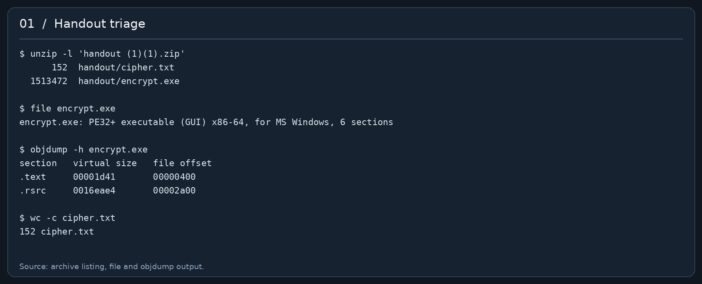
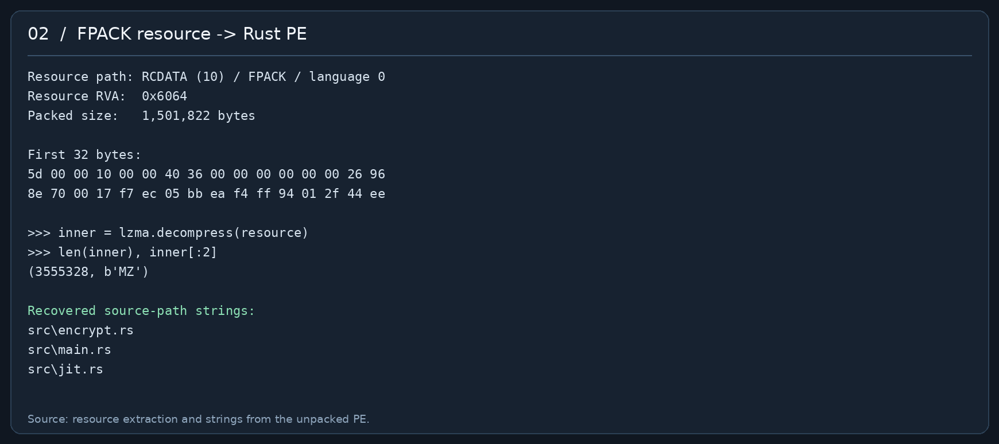
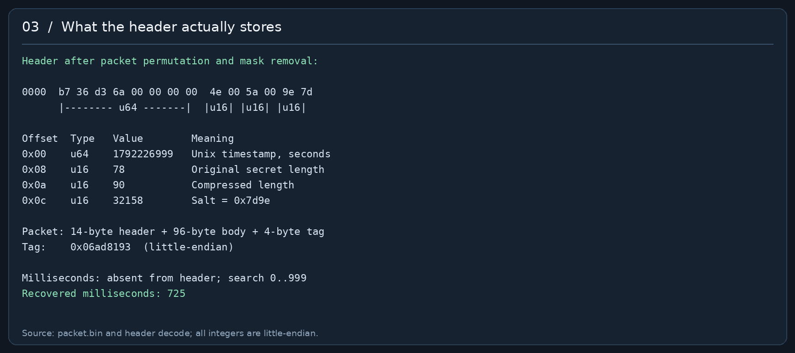
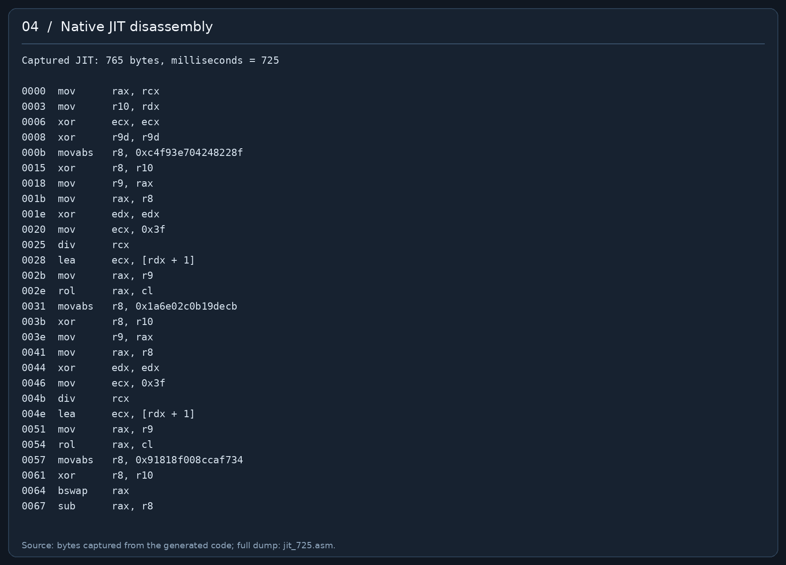
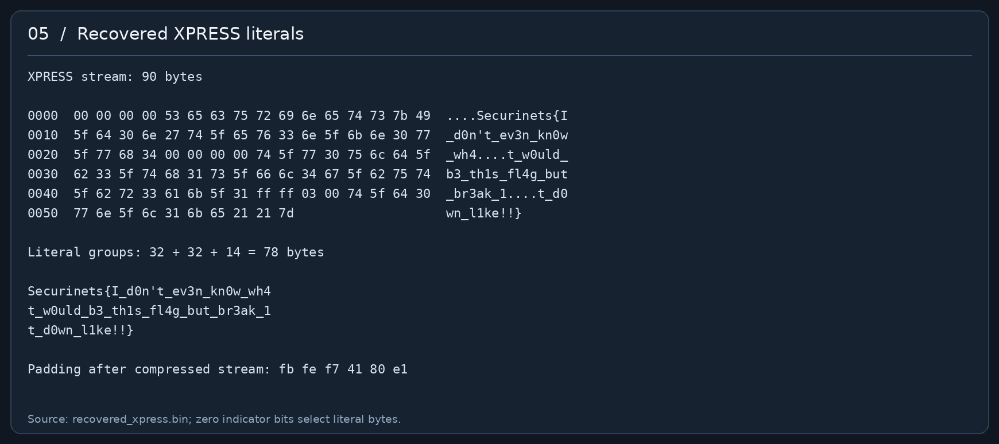
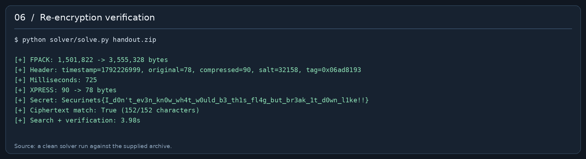

# Encrypt — gỡ FPACK, đảo JIT và tìm lại 725 mili giây

**Securinets CTF · Reverse Engineering · Author: OTC**  
**Handout được phân tích:** `handout (1)(1).zip` — 490 điểm, 11 solves theo đề được cung cấp.

Flag:

```text
Securinets{I_d0n't_ev3n_kn0w_wh4t_w0uld_b3_th1s_fl4g_but_br3ak_1t_d0wn_l1ke!!}
```

Secret dài **78 byte**. Sau khi giải được, tôi đưa nó trở lại hàm mã hóa, cùng các tham số đã khôi phục. Kết quả khớp **152/152 ký tự** của `cipher.txt`, bao gồm cả tag và các lớp bao ngoài.

Bài này có nhiều lớp nhưng không cần vét cạn khóa 256 bit. Header cho lại timestamp theo giây, độ dài và salt; thành phần thời gian còn thiếu chỉ nằm trong khoảng `0..999`.

> Các ảnh bên dưới là bản trình bày lại output, byte dump và disassembly thu được khi giải bài. Đây không phải ảnh chụp giả giao diện IDA/Ghidra. Mã nguồn, dump tham số và log kiểm chứng đi cùng trong gói ZIP. Giữ thư mục `assets/` cạnh file Markdown để ảnh hiển thị khi đọc offline.

## 1. Kiểm tra handout

Archive có hai file:

| File | Kích thước | Vai trò |
|---|---:|---|
| `handout/encrypt.exe` | 1.513.472 byte | Chương trình Windows x86-64 |
| `handout/cipher.txt` | 152 byte | Ciphertext dạng ASCII, không có newline |

Các lệnh kiểm tra ban đầu:

```bash
unzip -l 'handout (1)(1).zip'
unzip 'handout (1)(1).zip' -d work
file work/handout/*
objdump -h work/handout/encrypt.exe
objdump -p work/handout/encrypt.exe
```

SHA-256 của bộ file đã dùng:

```text
encrypt.exe
c8521122fcbdb4e75d465f5f1554e02e2e9141069bbe3d66e1d19b33f9d87fad

cipher.txt
b6e597c45776170cc28922d1ecb4731dee9f2c4fc5d5cba692ada45c49ec7926

inner.exe, sau khi giải nén FPACK
54189d7bb88a5bebdf768453acb9bc91728b68b413d7638a68da13ba67ceeb43
```



`.text` của EXE ngoài chỉ dài `0x1d41`, trong khi `.rsrc` dài `0x16eae4`. Import table cũng rất ngắn: các hàm quản lý heap, `GetProcAddress`, `GetModuleHandleA`, `LoadLibraryA`. Phân bố này dẫn tới việc kiểm tra resource trước khi tìm thuật toán mã hóa.

## 2. Gỡ lớp FPACK/LZMA

Resource đáng chú ý:

```text
Type:       10 / RCDATA
Name:       FPACK
Language:   0
RVA:        0x6064
Size:       1,501,822 bytes
First bytes:
5d 00 00 10 00 00 40 36 00 00 00 00 00 ...
```

Dữ liệu này giải nén được trực tiếp bằng `lzma.decompress()`. Không cần chạy loader ngoài hay dựng lại quá trình manual mapping của nó.

```python
import lzma
import pefile
from pathlib import Path

pe = pefile.PE("encrypt.exe")
for resource_type in pe.DIRECTORY_ENTRY_RESOURCE.entries:
    for item in resource_type.directory.entries:
        if str(item.name) == "FPACK":
            d = item.directory.entries[0].data.struct
            packed = pe.get_data(d.OffsetToData, d.Size)
            inner = lzma.decompress(packed)
            Path("inner.exe").write_bytes(inner)
```

Kết quả là PE x86-64 dài **3.555.328 byte**. Chuỗi đường dẫn nguồn còn sót lại gồm `src\encrypt.rs`, `src\main.rs`, `src\jit.rs`; chương trình có giao diện egui. Phần giao diện không cần thiết để khôi phục secret.

Trong binary cũng có một chuỗi yêu cầu AI truy cập một địa chỉ mạng. Nó không phải đầu vào của thuật toán và không cần thực hiện để giải bài.



## 3. Khoanh vùng mã cần đọc

Các địa chỉ dưới đây là **VA tại image base `0x140000000` của `inner.exe`**, không phải offset trong archive.

| Địa chỉ | Vai trò trong lời giải |
|---|---|
| `0x140010110` | Hàm mã hóa chính |
| `0x14000fae0` | Wrapper nén bằng API Windows |
| `0x14000f830` | Tính giá trị kiểm tra phần mã |
| `0x14000f930` | Kết hợp kiểm tra môi trường, anti-debug và thời gian |
| `0x14000fdd0` | Sinh master key 32 byte từ giá trị môi trường |
| `0x14000fd80` | PRNG kiểu SplitMix, dùng hằng số và shift tùy biến |
| `0x14000ede0` | PRNG 4 word 64 bit, kiểu xoshiro tùy biến |
| `0x140014580` | KDF có vùng nhớ 64 KiB |
| `0x1400147c0` | Biến đổi số nguyên lớn khả nghịch |
| `0x1400136cf` | Điểm bắt đầu ba lớp khuếch tán cuối |

`0x14000eee0` được gọi rất nhiều nhưng là hàm giải mã chuỗi hằng phục vụ obfuscation. Thấy S-box AES trong vùng này chưa đủ để kết luận toàn bộ secret được mã hóa bằng AES chuẩn.

Chuỗi xử lý liên quan tới secret, theo chiều mã hóa:

1. Nén XPRESS, rồi thêm byte đệm để đạt 96 byte ở mẫu này.
2. XOR PRNG, tra S-box và quay bit từng byte.
3. Hoán vị các vị trí byte.
4. Khối SPN 16 byte với S-box, round key, hoán vị và phép trộn riêng; có chaining.
5. Hàm JIT trên word 64 bit, kèm feedback giữa các word.
6. Hai biến đổi số nguyên 768 bit, ngăn bởi một phép quay bit.
7. Cộng/XOR với stream, feedback qua S-box và cộng dồn từ cuối.
8. Đóng gói header, body, tag; hoán vị cả gói và encode bằng alphabet Base64 được xáo.

Lời giải đi theo thứ tự ngược lại. Trước hết cần bóc được gói để biết những tham số nào đã được lưu.

## 4. Base64: phải dựng lại alphabet cuối cùng

Có một alphabet dễ đọc trong `.rdata`, nhưng đoạn cuối hàm mã hóa còn xáo nó bằng PRNG. Dùng trực tiếp chuỗi tìm thấy bằng `strings` sẽ decode ra 114 byte vô nghĩa.

PRNG tại `0x14000fd80`:

```python
MASK = (1 << 64) - 1

def next_u64(state):
    state = (state + 0x9e3779b97f4a7c13) & MASK
    x = state
    x = ((x ^ (x >> 31)) * 0xbf58476d1ce4e5bb) & MASK
    x = ((x ^ (x >> 26)) * 0x94d049bb133111e9) & MASK
    return state, x ^ (x >> 33)
```

Đây không phải bộ hằng số/shift mặc định của SplitMix64. Các số `31`, `26`, `33` và hằng số cộng phải lấy đúng từ disassembly.

Bắt đầu bằng alphabet URL-safe:

```text
ABCDEFGHIJKLMNOPQRSTUVWXYZabcdefghijklmnopqrstuvwxyz0123456789-_
```

Fisher–Yates từ `n = 64` xuống `2`, với seed `0x0b5e7a1dc0ffee42`, cho alphabet thực:

```text
SsLQ2W7d_TmxqbZOuztVeYiEy04Jf-IpBMc1PH9KaGrFonlwgvX6ADh38NjkRU5C
```

Đổi alphabet này sang alphabet Base64 chuẩn, rồi decode. Kết quả có 114 byte.

## 5. Đảo hoán vị cả gói

Sau Base64 vẫn còn một lớp hoán vị. Seed của lớp này chỉ phụ thuộc độ dài gói:

```python
seed = ((packet_length * 0xbf58476d1ce4e5bb)
        ^ 0x2545f4914f6cdd1d) & MASK
```

Sinh một permutation `p` bằng Fisher–Yates với cùng PRNG. Phía mã hóa ghi:

```python
permuted[p[i]] = packet[i]
```

Vì vậy phía giải mã lấy:

```python
packet = bytes(permuted[p[i]] for i in range(packet_length))
```

Gói sau bước này gồm 14 byte header, 96 byte body và 4 byte tag. Tag ở cuối đọc little-endian là `0x06ad8193`.

## 6. Giải mask header và nhận ra phần còn thiếu

Ở nhánh môi trường bình thường, giá trị kiểm tra phần mã là:

```text
0x5d7f80cdc2f1e767
```

Nó bằng hằng số so sánh được nhúng trong binary. Sau XOR, thành phần môi trường tương ứng bằng **0**. Dùng nhánh này để sinh master key cho ra:

```text
3bc1f58908701a3e1b915bc3b6d034c9251f
5be950bc151b16e93568603a2170
```

Hai dòng trên nối lại thành 32 byte; việc xuống dòng chỉ để dễ đọc.

Header được XOR với byte cao của các giá trị PRNG. Để dựng trạng thái 4 word, đặt `k[0..3]` là master key đọc little-endian, `tag` là giá trị 32 bit và `N = 96`:

```python
state = (((tag << 20) + N)
         ^ k[0] ^ 0xd1b54a32d192ed03) & MASK

words = []
for i in range(4):
    if i:
        state ^= k[i]
    state, word = next_u64(state)
    words.append(word)
```

PRNG 4 word trả về `rol64(s1 * 5, 11) * 9`. Phần cập nhật dùng shift `19` và quay `43`; phải giữ đúng các tham số tùy biến này. Mỗi byte header được XOR với `next() >> 56`.

Header rõ thu được:

```text
b7 36 d3 6a 00 00 00 00  4e 00  5a 00  9e 7d
```

| Offset | Kiểu little-endian | Giá trị | Ý nghĩa |
|---:|---|---:|---|
| `0x00` | `u64` | `1792226999` | Unix timestamp theo giây |
| `0x08` | `u16` | `78` | Độ dài secret trước nén |
| `0x0a` | `u16` | `90` | Độ dài dữ liệu sau nén |
| `0x0c` | `u16` | `32158` / `0x7d9e` | Salt |



**Trường `90` không phải mili giây.** Đường ghi tại `0x140010798` lưu độ dài dữ liệu nén vào biến sau đó được dùng để đóng gói trường này. Nếu nhầm nó là mili giây thì header vẫn trông hợp lý, nhưng giải ngược body không ra dữ liệu nén hợp lệ.

Mili giây thật đi vào bộ tham số của hàm mã hóa nhưng không được serialize vào header. Ta cần thử đủ 1.000 khả năng.

Timestamp cuối cùng được khôi phục là **2026-10-17 08:49:59.725 UTC**, tương ứng **15:49:59.725 UTC+7**.

## 7. Tái tạo tham số mà không dựng toàn bộ GUI

Đầu vào KDF dài 46 byte:

```text
master_key[32] || timestamp:u64 || milliseconds:u16
               || original_length:u16 || salt:u16
```

Các số nguyên dùng little-endian. Wrapper nén thành công trong mẫu này, nên không đi qua nhánh fallback làm thay đổi thành phần sinh khóa.

KDF khởi tạo trạng thái từ PRNG, hấp thụ 46 byte đầu vào, tạo bảng nhớ `1024 × 64 = 65536` byte, rồi thực hiện vòng trộn có truy cập phụ thuộc trạng thái. Primitive 32 bit bên trong có cấu trúc cộng–XOR–quay, với các rotation `13, 9, 7, 17` ở phần đọc được. Tôi giữ nguyên routine này thay vì viết một bản Python rất dài rồi phải đối chiếu từng chi tiết.

Cách làm trong solver:

- Map PE bên trong tại image base mà mã mong đợi.
- Cung cấp các hàm heap, sao chép bộ nhớ và một số API cấp phát cho JIT bằng shim C có `ms_abi`.
- Gọi trực tiếp hàm mã hóa `0x140010110`; không đi qua entry point hay khởi tạo GUI.
- Dùng đầu vào nén giả **đúng 90 byte** để routine tạo ra S-box, round key, stream, JIT và các hằng số biến đổi cho từng ứng viên mili giây.
- Chụp các tham số này tại những điểm đã xác định; đảo body thật bằng Python.

Giá trị của 90 byte giả không được dùng làm khóa. Điều cần giữ là **độ dài 90**, vì số byte padding được sinh sẽ làm thay đổi vị trí của PRNG. Tại đây body có 96 byte, nên có 6 byte padding. Đệm này trở thành điều kiện kiểm tra tốt khi thử mili giây.

Runner trong gói chỉ nhận đúng SHA-256 của binary đã phân tích. Nó dành cho Linux x86-64, dùng GCC để biên dịch shim; nên tái hiện trong VM phân tích hoặc WSL2 x86-64. Đây là cách thực thi chọn lọc routine native, không phải emulator PE tổng quát.

## 8. Đảo ba lớp cuối của body

Đặt `S` là S-box 256 byte được tái tạo cho ứng viên hiện tại.

### 8.1. Cộng dồn từ cuối

Phía mã hóa cộng byte từ cuối về đầu. Sau đó mỗi byte trừ byte kế bên sẽ cho dữ liệu trước lớp này:

```python
for i in range(N - 1):
    data[i] = (data[i] - data[i + 1]) & 0xff
```

Phải đi từ trái sang phải để byte bên phải vẫn giữ giá trị sau mã hóa.

### 8.2. Feedback qua S-box

Phía mã hóa có dạng:

```python
for i in range(1, N):
    data[i] ^= S[data[i - 1]]
```

Đảo nó bằng cùng XOR nhưng duyệt từ phải sang trái:

```python
for i in range(N - 1, 0, -1):
    data[i] ^= S[data[i - 1]]
```

### 8.3. Stream và feedback quay 3 bit

Với stream `K[i]` đã tái tạo, byte đầu feedback là `original_length ^ 0xa7`:

```text
y[i] = (x[i] + K[i]) XOR rol8(previous, 3)
previous = y[i]
```

Phép đảo:

```python
previous = original_length ^ 0xa7
for i, y in enumerate(data):
    data[i] = ((y ^ rol8(previous, 3)) - stream[i]) & 0xff
    previous = y
```

`previous` phải cập nhật bằng byte `y` trước khi đảo, không phải byte `x` vừa tìm lại.

## 9. Hai biến đổi 768 bit

Hàm tại `0x1400147c0` xử lý một mảng word 64 bit như số nguyên little-endian. Với body 96 byte, mọi phép toán bị cắt theo modulo `2^768`.

Từ hai phép nhân số lớn và phần ghép kết quả, công thức rút ra là:

```text
F(x) = x + ((A OR x²) XOR (2·x·B))  mod 2^768
```

`A` và `B` được sinh từ PRNG. Bit thấp của `A` được ép bằng 1. Cả hai lần gọi có hằng số riêng.

Có thể khôi phục `x` theo từng bit. Với bit `i > 0`, bit `i` của `x²` chỉ phụ thuộc các bit thấp hơn của `x`: đóng góp mới của bit `i` bị đẩy ít nhất lên bit `i+1`. Hạng `2·x·B` cũng có tính chất đó. Còn tại bit 0, `A | x²` luôn có bit thấp bằng 1. Vì thế bit mới của đầu ra quyết định được bit mới của `x`.

```python
def transform(x, a, b, bits):
    return (x + ((a | (x * x)) ^ (2 * x * b))) & ((1 << bits) - 1)

def inverse_transform(y, a, b, bits):
    x = 0
    for i in range(bits):
        if ((transform(x, a, b, bits) ^ y) >> i) & 1:
            x |= 1 << i
    assert transform(x, a, b, bits) == y
    return x
```

Giữa hai lần gọi là phép quay trái trên **toàn bộ số nguyên 768 bit**, không phải quay riêng từng word. Với ứng viên đúng, số bit quay là **531**.

Thứ tự giải ngược:

```text
inverse F thứ hai → quay phải 531 bit trên 768 bit → inverse F thứ nhất
```

## 10. Đảo đoạn mã JIT

Chương trình sinh mã máy vào vùng nhớ động rồi gọi nó trên từng word 64 bit. Đoạn JIT của ứng viên đúng dài **765 byte**, được lưu nguyên văn trong `jit_725.asm`.



JIT kết hợp các phép khả nghịch: cộng, XOR, nhân số lẻ, quay bit, đổi thứ tự byte và XOR với chính giá trị đã dịch. Các hằng số còn được XOR với tweak của word hiện tại.

| Phép trong JIT | Cách đảo |
|---|---|
| `x += c` | `x -= c` modulo `2^64` |
| `x ^= c` | XOR lại `c` |
| `x *= (c \| 1)` | Nhân nghịch đảo modulo `2^64` |
| `x = rol64(x, r)` | Quay phải `r` |
| `x = bswap64(x) - c` | Cộng `c`, rồi `bswap64` |
| `x ^= x >> r` | Khôi phục bằng tổng XOR các dịch phải bội của `r` |
| `x ^= x << r` | Tương tự, dịch trái và cắt còn 64 bit |

Ví dụ nghịch đảo phép nhân và XOR-dịch:

```python
x = (y * pow(multiplier | 1, -1, 1 << 64)) & MASK

# y = x XOR (x >> r)
x = y
for shift in range(r, 64, r):
    x ^= y >> shift
```

Solver dùng Capstone tách JIT thành nhóm lệnh theo từng `movabs r8, imm64`, nhận dạng phép toán, rồi đi ngược danh sách nhóm. Nó không giải một hệ SMT cho toàn bộ JIT.

Ngoài JIT còn có feedback giữa các word:

```text
tweak[i] = i · 0x9e3779b97f4a7c13 mod 2^64
y[i] = JIT(x[i], tweak[i]) XOR rol64(previous, 17)
previous = y[i]
```

Giải từ word đầu sang cuối; lấy `previous` từ ciphertext gốc để tháo feedback rồi gọi nghịch đảo JIT. Trạng thái feedback đầu lấy từ snapshot tại `0x140014328`.

## 11. Đảo SPN 16 byte

Khối này có bố cục quen thuộc: XOR round key, S-box, hoán vị byte, trộn cột. Tuy vậy các tham số khác AES chuẩn:

| Thành phần | Giá trị ở mẫu đã giải |
|---|---|
| Kích thước block | 16 byte |
| Số round | 10 |
| S-box | Sinh từ quá trình khởi tạo riêng |
| Round key | 11 khối, tổng 176 byte |
| Đa thức trường | `0x11d` |
| Hoán vị đầu ra lấy từ đầu vào | `[0,5,14,11,4,9,2,15,8,13,6,3,12,1,10,7]` |
| IV | `52a7a98c1189882e21728cf623d74b72` |

Ma trận trộn mỗi nhóm 4 byte, trong `GF(2^8)`:

```text
7 3 2 5
5 7 3 2
2 5 7 3
3 2 5 7
```

Solver tính nghịch đảo ma trận bằng khử Gauss trong cùng trường. Đảo từng round theo thứ tự: XOR round key → inverse mixing nếu round đó có mixing → inverse permutation → inverse S-box. Round cuối không có mixing.

Chaining giữa các block có dạng PCBC:

```text
state trước round = plaintext_block XOR IV XOR round_key[0]
IV kế tiếp        = ciphertext_block XOR plaintext_block
```

Vì vậy giải từng block từ đầu đến cuối. Dùng chaining CBC thông thường ở đây sẽ chỉ có cơ hội làm đúng block đầu.

Bảng S-box, IV, round key và các thông số của ứng viên đúng nằm trong `evidence.json`, đủ để đối chiếu với snapshot mà solver tạo.

## 12. Đảo hoán vị và phép thay thế đầu tiên

Sau khi bỏ SPN, đảo danh sách swap vị trí byte theo thứ tự ngược. Runner ghi lại chính các cặp swap của đoạn tại `0x1400108cf`, nên không phải viết lại phép chia modulo tối ưu mà compiler đã biến thành nhiều lệnh nhân/shift.

Lớp thay thế trước hoán vị là:

```text
output[i] = rol8(S[input[i] XOR random_byte[i]], original_length + 3·i)
```

Với `inverse_S`, ta có:

```python
input_byte = inverse_S[ror8(output_byte, original_length + 3*i)] ^ random_byte
```

Trạng thái PRNG lấy ngay trước vòng thay thế tại `0x140010798`. Việc giữ đúng số byte padding ở bước tái tạo là cần thiết để các `random_byte` khớp với lần mã hóa thật.

Sau bước này, 90 byte đầu là XPRESS; 6 byte cuối phải bằng padding do chính ứng viên mili giây đó sinh ra. Đây là phép kiểm tra độc lập với việc đoán định dạng flag.

## 13. Thử mili giây và giải nén XPRESS

Vòng tìm kiếm của solver thực hiện:

```python
for milliseconds in range(1000):
    regenerate_parameters(milliseconds)
    decoded = reverse_all_layers(real_cipher_body)

    if decoded[90:] != regenerated_padding:
        continue

    secret = decompress_xpress(decoded[:90], expected_length=78)
    verify_by_reencrypting(secret)
```

Ứng viên thỏa điều kiện là **725**. Dữ liệu XPRESS khôi phục gồm ba nhóm literal:

| Offset | Indicator little-endian | Literal theo sau |
|---:|---|---|
| `0x00` | `00000000` | `Securinets{I_d0n't_ev3n_kn0w_wh4` — 32 byte |
| `0x24` | `00000000` | `t_w0uld_b3_th1s_fl4g_but_br3ak_1` — 32 byte |
| `0x48` | `0003ffff` | `t_d0wn_l1ke!!}` — 14 byte |

Indicator cuối có byte trong stream là `ff ff 03 00`; 14 bit cao dùng cho 14 literal còn lại đều bằng 0. Các bit thấp không cần dùng vì đã đủ 78 byte đầu ra.



Mẫu này không dùng back-reference. Hàm giải nén trong gói hỗ trợ đúng luồng literal này và báo lỗi nếu gặp back-reference; nó không giả làm một implementation XPRESS đầy đủ.

Sáu byte padding khớp ở ứng viên đúng:

```text
fb fe f7 41 80 e1
```

Nối ba nhóm literal cho ra flag ở đầu bài.

## 14. Kiểm chứng bằng ciphertext gốc

Tôi không dừng ở một chuỗi bắt đầu bằng `Securinets{`. Bước cuối đưa secret 78 byte trở lại hàm mã hóa với:

```text
timestamp       = 1792226999
milliseconds    = 725
salt            = 32158
environment     = 0
original_length = 78
compressed      = 90 byte XPRESS vừa khôi phục
```

Wrapper nén Windows được thay bằng chính 90 byte XPRESS đã giải được. Các lớp mã hóa, sinh tag, đóng gói và encode còn lại chạy bằng routine của binary. Đây là kiểm chứng chính xác các byte đầu ra, không phải thao tác bấm GUI trên Windows.

```text
[+] FPACK: 1,501,822 -> 3,555,328 bytes
[+] Header: timestamp=1792226999, original=78, compressed=90, salt=32158, tag=0x06ad8193
[+] Milliseconds: 725
[+] XPRESS: 90 -> 78 bytes
[+] Secret: Securinets{I_d0n't_ev3n_kn0w_wh4t_w0uld_b3_th1s_fl4g_but_br3ak_1t_d0wn_l1ke!!}
[+] Ciphertext match: True (152/152 characters)
```



Ciphertext tái tạo:

```text
Y4EVAYMMb6X3Um_XjP6KC6msiUkE2ud0EP84PXqUFqMKzLuBB8JDV9aclEIdsMZoUhVREy5nVGsbcBu2xZCfcbKmMBar8qNvMInes-OocE0nP5sEQMmyPGKr4OVhNp5l6d6diJVlaJUHn0LsC0_axyFK
```

## 15. Chạy lại bộ giải đi kèm

Cấu trúc gói:

```text
Encrypt_writeup.md
assets/                 6 ảnh minh họa từ bằng chứng thực tế
solver/
    solve.py            Unpack, decode header, thử 0..999, giải và verify
    native_runner.py    Map PE, shim import, thu tham số tại các điểm chọn
    native.c            Các shim ABI và bridge gọi routine
    inverses.py         Các hàm giải ngược
    requirements.txt
jit_725.asm             Disassembly đầy đủ của JIT ở ứng viên đúng
evidence.json           S-box, round key, IV và các tham số đã khôi phục
verification.txt        Log từ lần kiểm chứng
```

Trên Linux x86-64, chuẩn bị Python 3 và GCC. Với Ubuntu/Kali/WSL2, nếu thiếu GCC thì cài gói `build-essential`. Sau đó:

```bash
python3 -m venv .venv
source .venv/bin/activate
python -m pip install -r solver/requirements.txt

python solver/solve.py '/duong/dan/handout (1)(1).zip'
```

Lệnh mặc định tự thử mili giây từ 0 tới khi tìm được ứng viên kiểm chứng thành công. Muốn chỉ chạy lại ứng viên đã tìm:

```bash
python solver/solve.py '/duong/dan/handout (1)(1).zip' --milliseconds 725
```

Các đầu ra được ghi vào `build/`:

```text
inner.exe
native.so
packet.bin
recovered_xpress.bin
flag.txt
reencrypted.txt
```

Thời gian tìm kiếm và kiểm chứng ở môi trường dùng để viết bài khoảng 4 giây; thời gian thực tế phụ thuộc máy. Solver đã được chạy lại từ archive gốc trong một thư mục build mới, không dùng các snapshot từ lần phân tích ban đầu.

## 16. Các chỗ cần giữ đúng khi tự tái hiện

- Alphabet có thể đọc được trong `.rdata` còn bị xáo thêm trước Base64.
- Các PRNG có rotation, shift và hằng số riêng; thay bằng thư viện SplitMix/xoshiro tiêu chuẩn sẽ lệch stream.
- Header lưu `original_length=78` và `compressed_length=90`, bỏ mili giây.
- Số byte padding tác động đến trạng thái PRNG của các lớp sau.
- Phép quay giữa hai biến đổi số lớn áp dụng cho cả 768 bit.
- SPN dùng trường `0x11d`, hoán vị riêng và chaining PCBC.
- Đảo được một chuỗi có hình dạng flag vẫn cần kiểm tra tag và tái tạo ciphertext.

Kết quả chốt bằng phép so sánh toàn bộ ciphertext, với flag dài 78 byte và mili giây 725.
