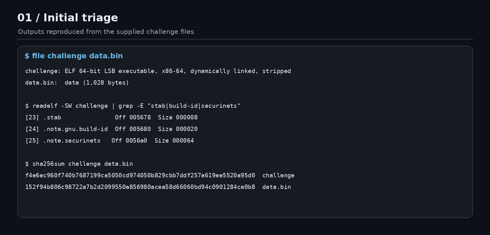
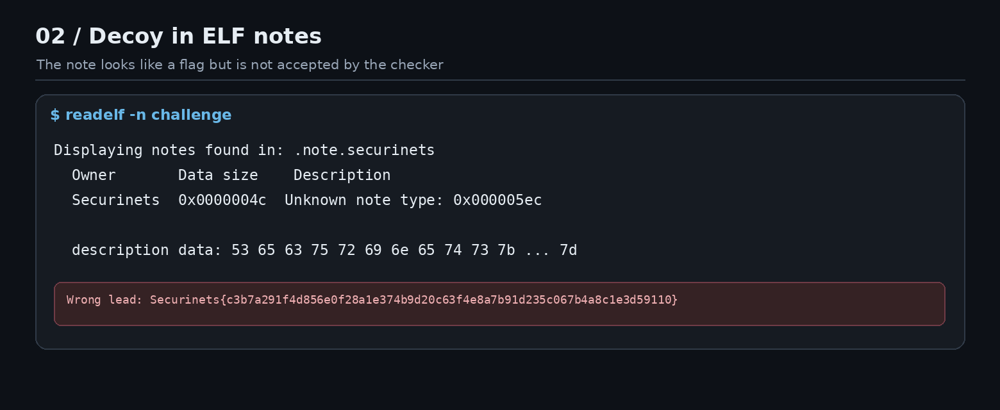
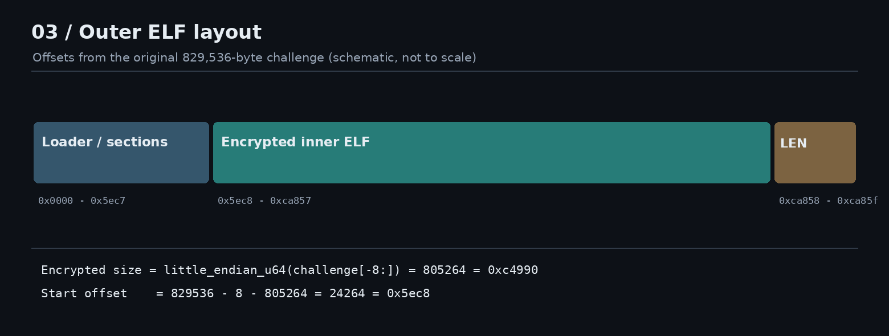
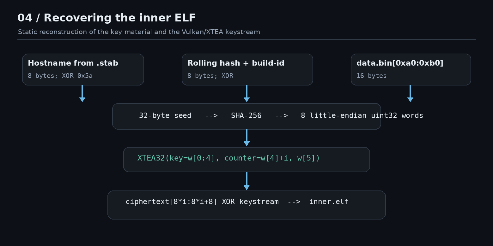
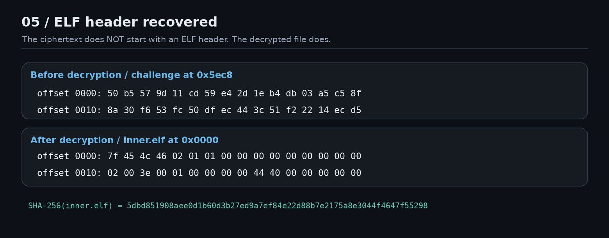
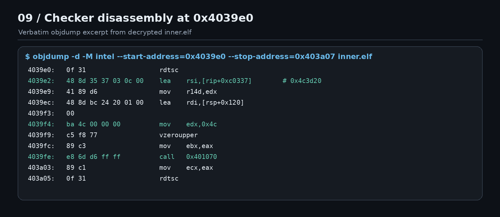
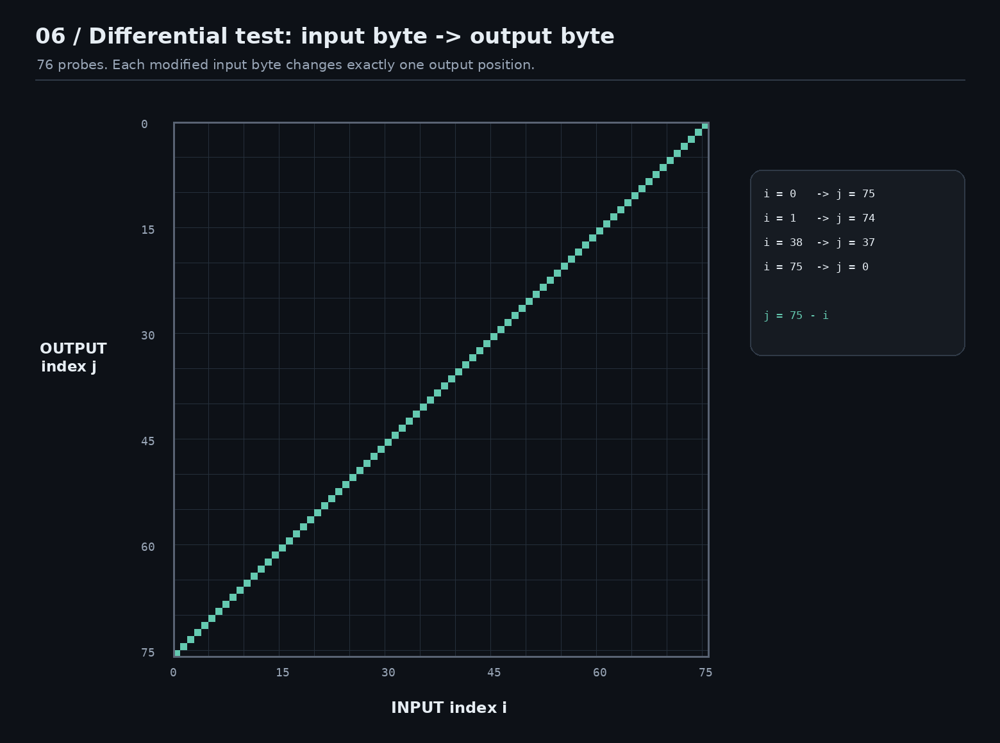
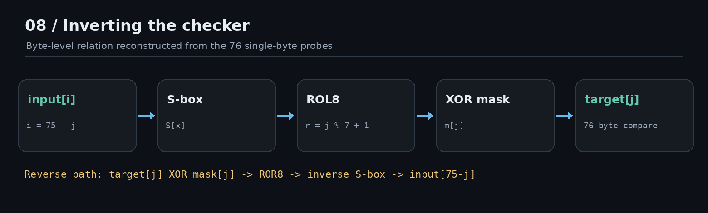
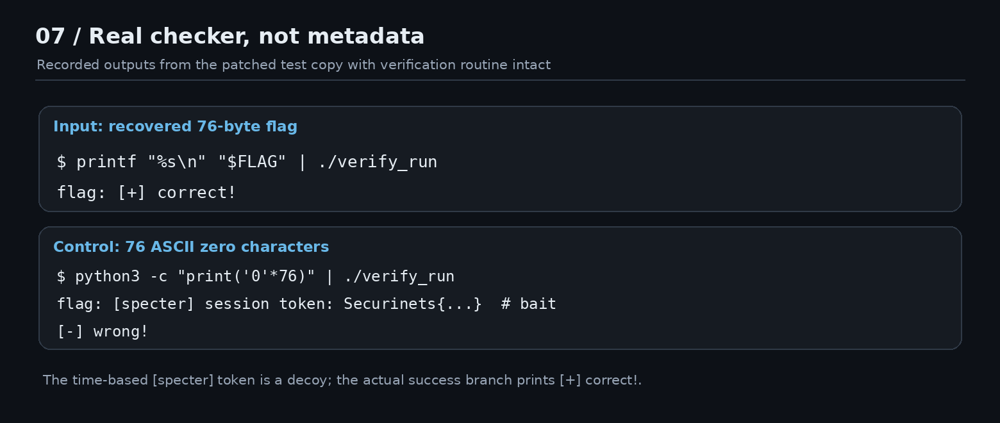

# revenant — bóc loader Vulkan, giải mã ELF thứ hai và đảo ngược checker

> **Reverse Engineering · 494 pts · 7 solves · Author: blackkader**  
> **Đầu vào:** `revenant.zip` (mật khẩu do đề cung cấp)  
> **Kết quả:** `Securinets{5db6ce3527dfeeafdf5da028ab9282f2bf2fe34400fa06da794cc50afaa43c0e}`

## TL;DR

Không cần brute-force 64 ký tự hex. `challenge` là một loader ELF, không phải checker cuối cùng. Nó đọc metadata của chính nó và `data.bin`, ghép một seed 32 byte, SHA-256, rồi dùng keystream **XTEA 32 rounds** trong SPIR-V/Vulkan để XOR giải mã thêm **một ELF 805.264 byte** ở cuối file. ELF được giải mã thực hiện kiểm tra 76 byte bằng S-box, đảo vị trí byte, rotate và XOR với mask. Thu lại trạng thái checker sau constructor và một output của đầu vào `'0' * 76` là đủ để đảo hàm và lấy flag. Kết quả được xác nhận bằng nhánh `flag: [+] correct!` của checker.

**Đường đi thực tế:** `zip → challenge + data.bin → seed SHA-256 → Vulkan/XTEA → inner.elf → dump checker state → differential probe → invert → flag`.

Tất cả hình bên dưới đều được dựng lại từ **output lệnh, byte thực của mẫu và log phép thử**; không dùng ảnh minh họa giả lập giao diện Ghidra/IDA. Các địa chỉ được ghi rõ **file offset** hay **virtual address (VA)**.

## 0. Môi trường và quy tắc kiểm tra

- Phân tích tĩnh: `file`, `readelf`, `objdump`, `strings`, Python 3; không cần debugger ở giai đoạn giải mã loader.
- Giai đoạn probe checker chỉ thực hiện với **bản sao `inner.elf` đã sửa để ghi dữ liệu** trong VM CTF tách biệt, quyền thấp, không mạng. **Không chạy `challenge` chưa kiểm tra trực tiếp trên máy chính**.
- Trình bày dưới đây dựa trên mẫu có SHA-256:

| File | Kích thước | SHA-256 |
|:---|---:|:---|
| `challenge` | 829.536 B | `f4e6ec960f740b7687199ca5050cd974050b829cbb7ddf257a619ee5520a95d0` |
| `data.bin` | 1.028 B | `152f94b806c98722a7b2d2099550a856980acea58d66060bd94c0901284ce0b8` |
| `inner.elf` (sau giải mã) | 805.264 B | `5dbd851908aee0d1b60d3b27ed9a7ef84e22d88b7e2175a8e3044f4647f55298` |

Các lệnh và kết quả trong bài dành riêng cho phiên bản này. Nếu hash khác, không nên áp nguyên offset.

---

## 1. Triage: vì sao không tin chuỗi `Securinets{...}` đầu tiên?

Giải nén bằng đúng password trong đề:

```bash
unzip -P 'ffc042712911f02a0e3db9cbf2bf9747372426f65466f889830fff3b65917ae9' revenant.zip
file challenge data.bin
sha256sum challenge data.bin
readelf -SW challenge
```

`challenge` là ELF64 x86-64 **dynamically linked, stripped**. Ngoài `.text`/`.rodata`, có các section không bình thường:

```text
[23] .stab               file offset 0x5678  size 0x08
[24] .note.gnu.build-id  file offset 0x5680  size 0x20
[25] .note.securinets    file offset 0x56a0  size 0x64
```



Một lệnh dễ khiến đi sai hướng:

```bash
readelf -n challenge
```

Nó liệt kê `.note.securinets` và byte mô tả được giải ra:

```text
Securinets{c3b7a291f4d856e0f28a1e374b9d20c63f4e8a7b91d235c067b4a8c1e3d59110}
```

Đây **không phải flag**; đã thử và bị từ chối. Note không chứng minh đó là đầu vào được nhánh kiểm tra cuối cùng chấp nhận. Với bài đặt tên *revenant* và gợi ý *“The binary is dead on arrival. Or is it?”*, cách hợp lý là theo đường thực thi thay vì tìm chuỗi.



**Kết luận bước 1:** mục tiêu là tìm nơi dữ liệu đầu vào được kiểm tra, không phải nộp string đẹp đầu tiên.

## 2. Xác định loader và lớp anti-analysis

Bắt đầu với:

```bash
objdump -d -M intel challenge > challenge.disasm
strings -a challenge | grep -Ei 'proc/self|TracerPid|vulkan|data.bin'
readelf -l challenge
```

Các điểm cần bám khi lần theo `.text` (VA của **outer ELF**):

| Vùng VA | Ý nghĩa khi dịch ngược |
|:---|:---|
| `0x1003171`–`0x100326d` | Đọc `/proc/self/status`, kiểm tra `TracerPid` / chống debugger |
| `0x1003275`–`0x100343e` | Đọc ELF của `/proc/self/exe`, tìm `.stab` và `.note.gnu.build-id` |
| `0x10034f3`–`0x100352f` | Giải XOR một stub 42 byte và chạy rolling hash trên dữ liệu |
| `0x1003580`–`0x100368e` | Chuẩn bị seed / SHA-256 |
| `0x10039e2`–`0x1003d86` | Khởi tạo và chạy compute shader Vulkan |
| `0x1003dab` trở đi | So sánh đầu ra với magic bytes `7f 45 4c 46` (`\x7fELF`) |

Ví dụ ở `0x1003dab`, thấy rõ so sánh trực tiếp với ELF magic:

```asm
1003dab: cmp BYTE PTR [r12],     0x7f
1003db6: cmp BYTE PTR [r12+0x1], 0x45
1003dc2: cmp BYTE PTR [r12+0x2], 0x4c
```

Đây là chứng cứ loader **mong chờ một ELF khác**, nên việc tìm checker ở binary ngoài là sai tầng.

Một số text/đường dẫn được tạo hoặc decode tại runtime chứ không tồn tại như string liền mạch. Vì vậy `strings` chỉ là bước đầu; thông tin quan trọng lấy từ disassembly và vị trí của bytes.

## 3. Payload nằm ở đâu trong file?

Loader lấy 8 byte cuối làm độ dài payload `uint64_t` little-endian. Không cần chạy loader:

```python
from pathlib import Path
import struct

raw = Path('challenge').read_bytes()
length = struct.unpack_from('<Q', raw, len(raw) - 8)[0]
start = len(raw) - 8 - length
print(hex(start), length)
# 0x5ec8 805264
```

Do đó:

```text
file size                = 829536 bytes (0xca860)
payload start (file off) = 0x5ec8  (24264)
payload length           = 805264 (0xc4990)
8-byte length trailer    = 0xca858 .. 0xca85f
```

> Nhớ phân biệt: các số `0x1003...` ở bước 2 là **VA** trong outer ELF; `0x5ec8` là **file offset** vào chính file `challenge`.



Đoạn đầu payload chưa phải `7f 45 4c 46`:

```text
50 b5 57 9d 11 cd 59 e4 2d 1e b4 db 03 a5 c5 8f
```

=> Phải giải mã, không thể dùng `dd` tách xong chạy như ELF.

## 4. Khôi phục seed SHA-256: điểm khó của outer layer

### 4.1. Hostname bị XOR trong `.stab`

Ở file offset `0x5678`, 8 byte là:

```text
38 36 3b 39 31 31 3b 3e
```

Đảo `XOR 0x5a`:

```python
hostname = bytes(x ^ 0x5a for x in raw[0x5678:0x5680])
assert hostname == b'blackkad'
```

Giá trị này đóng vai trò material cho SHA-256; không cần đổi hostname máy phân tích thành `blackkad`.

### 4.2. Rolling hash nằm trong stub 42 byte

Stub được outer loader giải mã để chạy, nhưng logic tương đương hàm sau, dùng **256 byte đầu tiên của `data.bin`**:

```python
MASK64 = (1 << 64) - 1
state = 0
for value in data_bin[:256]:
    state = (((state >> 1) | (state << 63)) & MASK64) ^ value
    state = (state + 0xBF58476D1CE4E5B9) & MASK64
```

Lưu ý phép rotate 64 bit và `& MASK64` ở **mỗi vòng**, không chỉ ở cuối. Sai phép này thì SHA seed cũng sai, XTEA sẽ ra nhiễu hoàn toàn.

### 4.3. Ghép seed theo đúng thứ tự

Dùng 8 byte tại `.note.gnu.build-id` **file offset `0x5694:0x569c`**, rồi XOR với rolling hash đã pack little-endian. Cuối cùng nối thêm `data.bin[0xa0:0xb0]`:

```python
import hashlib, struct

part1 = b'blackkad'  # 8 bytes
h8 = struct.pack('<Q', state)
part2 = bytes(a ^ b for a, b in zip(h8, raw[0x5694:0x569c]))  # 8 bytes
part3 = data_bin[0xa0:0xb0]                                   # 16 bytes
seed = part1 + part2 + part3                                  # 32 bytes
digest = hashlib.sha256(seed).digest()
```

Kết quả của mẫu:

```text
SHA256(seed):
5a1818ddf23f47cbd90f96b570221ce4a9258f0c7b2662e44dd0f9fac008be56
```

Đây là digest **seed**, không phải flag và không phải SHA-256 của `.text`.



## 5. Vulkan chỉ là vỏ: bên trong là XTEA-CTR-like keystream

Tại **file offset `0xfec`**, outer ELF chứa blob 3332 byte mở đầu bằng:

```text
03 02 23 07 00 00 01 00 ...
```

`03 02 23 07` là magic little-endian của **SPIR-V**. Shader không phục vụ đồ họa: nó sinh block keystream 8 byte rồi XOR với ciphertext. Truy vết phép cộng `0x9e3779b9`, chọn key index bởi `sum & 3` và `(sum >> 11) & 3` cho thấy **XTEA, 32 vòng**.

```python
import struct

MASK32 = 0xffffffff
words = struct.unpack('<8I', digest)

def xtea_stream(v0, v1, key):
    total = 0
    for _ in range(32):
        mix = (((v1 << 4) ^ (v1 >> 5)) + v1) & MASK32
        v0 = (v0 + (mix ^ ((total + key[total & 3]) & MASK32))) & MASK32
        total = (total + 0x9e3779b9) & MASK32
        mix = (((v0 << 4) ^ (v0 >> 5)) + v0) & MASK32
        v1 = (v1 + (mix ^ ((total + key[(total >> 11) & 3]) & MASK32))) & MASK32
    return struct.pack('<II', v0, v1)

payload = raw[start:-8]
out = bytearray(len(payload))
for i in range(len(payload) // 8):
    stream = xtea_stream((words[4] + i) & MASK32, words[5], words[:4])
    for k in range(8):
        out[i * 8 + k] = payload[i * 8 + k] ^ stream[k]

assert out[:4] == b'\x7fELF'
Path('inner.elf').write_bytes(out)
```

Điểm dễ sai: đây không phải lấy digest SHA-256 trực tiếp XOR với payload, cũng không phải decrypt XTEA theo CBC. Mỗi block có counter `words[4] + i`, giá trị `words[5]` cố định, key là bốn word `words[0:4]`. Việc XTEA được dùng để **encrypt counter tạo keystream** là lý do phải gọi hàm encrypt chứ không gọi decrypt.



Kiểm tra:

```bash
file inner.elf
readelf -h inner.elf | grep -E 'Entry point|Machine|Type'
sha256sum inner.elf
```

```text
inner.elf: ELF 64-bit LSB executable, x86-64, statically linked, stripped
Entry point address: 0x404400
SHA256: 5dbd851908aee0d1b60d3b27ed9a7ef84e22d88b7e2175a8e3044f4647f55298
```

Script đầy đủ, đã chạy đối chiếu `inner.elf` **byte-for-byte**: [`revenant_writeup_support/extract_inner.py`](revenant_writeup_support/extract_inner.py).

## 6. `inner.elf`: làm sao tìm checker giữa nhiễu?

`inner.elf` là ELF **statically linked**. Khi chạy trong môi trường không khớp, nó có thể chỉ in `still dead.` hoặc rẽ sang đường gây nhiễu. Ngoài ra có message chứa giả flag/time-based session token dạng `Securinets{...}`. Chúng không phải nhánh đúng.

Các vị trí quyết định, giờ là VA của **inner ELF**:

| VA | Vai trò |
|:---|:---|
| `0x403bc0` | Constructor khởi tạo dữ liệu checker |
| `0x404050` | `main` |
| `0x4c2338` | Ô nhớ chứa function pointer gọi checker `0x403040` |
| `0x403040` | Checker thực tế (nhiều biến đổi vector hóa AVX) |
| `0x4039e0` | Trước thời điểm so sánh buffer đã biến đổi |
| `0x4c3d20` | Target 76 byte trong vùng dữ liệu runtime |
| `0x4c3e40` | S-box 256 byte |

Minh chứng compare trong checker (trích `objdump -d -M intel inner.elf`):

```asm
4039e2: lea rsi, [rip+0xc0337]    ; -> 0x4c3d20 (expected)
4039ec: lea rdi, [rsp+0x120]     ; -> transformed input
4039f4: mov edx, 0x4c            ; 0x4c = 76 bytes
4039fe: call 0x401070           ; comparison routine
```



Cụm lệnh AVX/SSE làm phần transform khá rối nếu cố đọc từng instruction, nhưng đầu vào/đầu ra của checker dễ đo được và vẫn chứng minh được toán học.

### 6.1. Dump state sau constructor

Không lấy riêng `.data` file rồi giả định nó là trạng thái cuối: constructor đã dựng các byte. Cách dùng trong lần giải này là tạo một **bản sao instrumented**: thay phần đầu `main` tại **file offset `0x4050`** (VA `0x404050`) thành `write(1, 0x4c3d00, 0x2000); exit(0)`. Constructor vẫn chạy trước `main`.

Script tạo bản sao: [`revenant_writeup_support/patch_inner.py`](revenant_writeup_support/patch_inner.py).

Trong **VM CTF cô lập**, sau khi tạo `inner.elf`:

```bash
python3 revenant_writeup_support/patch_inner.py inner.elf
./dump_state.elf > constructor_state.bin
```

Dùng các lát cắt **tính theo vùng memory `0x4c3d00`**:

```python
state = open('constructor_state.bin', 'rb').read()
assert len(state) == 8192
expected = state[0x20 : 0x20 + 76]   # address 0x4c3d20
sbox     = state[0x140: 0x140+256]  # address 0x4c3e40
assert len(set(sbox)) == 256         # S-box có thể đảo
```

Cần lưu ý một vài byte khác trong bản dump có thể thay đổi giữa các lần chạy (con trỏ/trạng thái không liên quan), nhưng **76 byte target và 256 byte S-box giống nhau**.

### 6.2. Dump buffer transform trước khi `memcmp`

Ở một bản sao khác, patch **file offset `0x39e0`** (VA `0x4039e0`) thành `write(1, rsp+0x120, 76); exit(0)`, tức ghi toàn bộ buffer đã biến đổi ra stdout **trước lúc so sánh**. Bản này bỏ qua một nhánh môi trường tại file offset `0x4060` bằng 6 byte NOP, nhưng không thay logic biến đổi.

Script trên tạo `dump_transform.elf` theo cách này. Nó vẫn in prompt `flag: ` trước khi ghi 76 byte raw; vì vậy **không được** xem stdout là chuỗi text thuần.

Trong VM:

```bash
python3 - <<'PY'
import subprocess
p = subprocess.run(['./dump_transform.elf'], input=b'0'*76+b'\n',
                   stdout=subprocess.PIPE, check=True)
assert p.stdout.startswith(b'flag: ')
probe = p.stdout[6:]
assert len(probe) == 76
open('baseline_zeros.bin', 'wb').write(probe)
print('baseline:', probe.hex())
PY
```

Bản baseline có trong gói đính kèm (76 byte), nên **để chỉ khôi phục flag, không cần chạy ELF lạ**.

### 6.3. Differential test: tìm phép đảo chỉ từ input/output

Sau khi có probe của `'0' * 76`, thay từng ký tự thành `'1'`, chạy lại dump transform rồi so sánh hai buffer:

```python
baseline = transform(b'0' * 76)
for i in range(76):
    trial = bytearray(b'0' * 76)
    trial[i] = ord('1')
    output = transform(bytes(trial))
    changed = [j for j in range(76) if output[j] != baseline[j]]
    print(i, changed)
```

Trong quá trình phân tích, kết quả đúng mẫu:

```text
0  [75]
1  [74]
2  [73]
...
38 [37]
...
74 [1]
75 [0]
cardinality: Counter({1: 76})
distinct outputs: 76
```

**Đây là lý do có thể suy ra vị trí tương ứng `j = 75 - i`**, thay vì đoán do thấy giá trị “trông giống reverse”. Hình dưới là ma trận 76×76 dựng từ `diff.log` thật: mỗi cột là vị trí input thay đổi, mỗi hàng là vị trí output bị ảnh hưởng; đường chéo ngược là toàn bộ 76 điểm đo.



## 7. Đảo ngược chính xác phép biến đổi 76 byte

Tổng hợp những gì quan sát được từ checker + probe:

1. Với output index `j`, byte input tương ứng là `x[75-j]`.
2. Áp S-box `S[x[75-j]]`.
3. Rotate-left 8 bit với `r = j % 7 + 1`.
4. XOR với mask riêng vị trí `m[j]`.
5. So sánh output với `target[j]`, độ dài **76 byte**.

Viết gọn:

\[
T[j] = \operatorname{ROL}_8\bigl(S(x[75-j]),\,j\bmod 7+1\bigr) \oplus m[j].
\]

Biết output của đầu vào toàn `'0'` (`Z[j]`), suy ra mask không cần đọc/xử lý hết vectorized code:

\[
m[j] = Z[j] \oplus \operatorname{ROL}_8\bigl(S(0x30),\,j\bmod 7+1\bigr).
\]

Sau đó đảo từng output byte:

\[
x[75-j] = S^{-1}\left(\operatorname{ROR}_8\bigl(T[j]\oplus m[j],\,j\bmod7+1\bigr)\right).
\]



### Ví dụ tính tay byte đầu của flag

Với `i = 0`, chọn `j = 75`, `r = 75 % 7 + 1 = 6`. Từ dump:

```text
S[ord('0')] = 0xc8
Z[75]      = 0xc6
T[75]      = 0x02
mask[75]   = 0xc6 XOR ROL8(0xc8, 6) = 0xf4
S[x[0]]    = ROR8(0x02 XOR 0xf4, 6) = 0xdb
inverse_S[0xdb] = 0x53 = 'S'
```

Tức ký tự đầu tiên là `S` **do tính ra**, không phải ép theo prefix `Securinets{`. Ví dụ với ký tự cuối `i=75`, chọn `j=0`, tính được `0x7d = '}'`.

### Script đảo biến đổi

Đây là lõi của [`revenant_writeup_support/solve_checker.py`](revenant_writeup_support/solve_checker.py):

```python
state = open('constructor_state.bin', 'rb').read()
Z = open('baseline_zeros.bin', 'rb').read()
T = state[0x20:0x20+76]
S = state[0x140:0x140+256]
Sinv = {value: index for index, value in enumerate(S)}

rol8 = lambda b, r: ((b << r) | (b >> (8-r))) & 255
ror8 = lambda b, r: ((b >> r) | (b << (8-r))) & 255

flag = bytearray(76)
for i in range(76):
    j = 75-i
    r = j % 7 + 1
    mask = Z[j] ^ rol8(S[ord('0')], r)
    sbox_value = ror8(T[j] ^ mask, r)
    flag[i] = Sinv[sbox_value]

print(flag.decode('ascii'))
```

Kết quả:

```text
Securinets{5db6ce3527dfeeafdf5da028ab9282f2bf2fe34400fa06da794cc50afaa43c0e}
```

Nếu forward lại từ flag vừa tìm, output **trùng đủ 76/76 byte** với target. Target gốc (hex):

```text
06f888e4a922af90eeced6127d8cacb01ed752cc77b2a21381f531b6fc49cbb84385fe70b8bd8f94231e95b9a1e9923f62f049fba95f662de6b6d8be03e0032923a3a18935ccaefe0082ab02
```

## 8. Xác minh thực tế: đúng và đối chứng sai

Phần này được thực hiện trên bản `verify_run` **chỉ bỏ qua nhánh khởi động gây `still dead`**, không thay hàm checker. Script `patch_inner.py` đi kèm tạo bản tương đương là `verify.elf`.

Trong VM cách ly:

```bash
printf '%s\n' 'Securinets{5db6ce3527dfeeafdf5da028ab9282f2bf2fe34400fa06da794cc50afaa43c0e}' | ./verify.elf
```

```text
flag: [+] correct!
```

Đối chứng:

```bash
python3 -c "print('0' * 76)" | ./verify.elf
```

```text
flag: [specter] session token: Securinets{...}
[-] wrong!
```



Token của `[specter]` có thể thay đổi theo mỗi lần chạy; không phải flag và không cần chép lại. Điểm quyết định là **kết quả của nhánh checker**, `[+] correct!` hay `[-] wrong!`.

> **Giới hạn xác minh:** đã qua checker ELF bên trong; không có quyền truy cập hệ thống nộp bài để xác nhận từ phía scoreboard. Đây là kết quả kiểm chứng trên chính binary, không phải đoán dựa trên flag format.

## 9. Chạy lại toàn bộ (từ các file gốc)

Gói ZIP chứa file `.md`, 9 ảnh `.png` và ba script Python cùng hai file dữ liệu tối thiểu phục vụ tái hiện. Không đóng gói bản thực thi không tin cậy.

**A. Giải mã `inner.elf` bằng Python tĩnh — không chạy loader:**

```bash
python3 revenant_writeup_support/extract_inner.py challenge data.bin inner.elf
sha256sum inner.elf
```

Kết quả SHA-256 phải là `5dbd851908aee0d1b60d3b27ed9a7ef84e22d88b7e2175a8e3044f4647f55298`.

**B. Lấy flag ngay từ state/probe đã lưu — không chạy ELF:**

```bash
python3 revenant_writeup_support/solve_checker.py \
  revenant_writeup_support/constructor_state.bin \
  revenant_writeup_support/baseline_zeros.bin
```

Output:

```text
Flag: Securinets{5db6ce3527dfeeafdf5da028ab9282f2bf2fe34400fa06da794cc50afaa43c0e}
Length: 76 bytes | S-box: 256 unique values
Forward verification: 76/76 bytes match
```

**C. Muốn tự tạo lại state/probe thay vì tin file đính kèm:** dùng `patch_inner.py` theo mục 6, chỉ thực hiện trong môi trường sandbox CTF. Khi so sánh state dump, so 76 byte target và 256 byte S-box; không so toàn bộ 8 KiB vì các vùng khác có thể thay đổi theo môi trường/lần chạy.

## 10. Những nhánh sai tốn thời gian

| Hướng sai | Vì sao sai | Điều cần kiểm chứng thay thế |
|:---|:---|:---|
| Dùng chuỗi trong `.note.securinets` | Đó là dữ liệu note có format flag nhưng bị từ chối | Theo tới hàm `memcmp` checker |
| Hash `.text` rồi đoán flag | Chương trình có thông điệp gây nhiễu về hash | Đọc dataflow seed SHA-256 thực sự |
| Tách ciphertext rồi thử `file` | Payload vẫn là dữ liệu đã mã hóa | Trailer length + keystream XTEA |
| Xem Vulkan là đồ họa | Shader đang làm phép biến đổi byte | Magic SPIR-V, hằng XTEA, XOR output |
| Brute-force 64 hex chars | Không cần; checker là hàm bytewise đảo được | Dump target/S-box, probe một baseline |
| Tin `[specter]` token | Token xuất hiện cả ở nhánh sai | Tìm nhánh `correct` thực tế |

## Flag

```text
Securinets{5db6ce3527dfeeafdf5da028ab9282f2bf2fe34400fa06da794cc50afaa43c0e}
```

---

### Tài liệu gốc và cách tạo hình

- `revenant.zip` (challenge binary do đề bài cung cấp); mọi byte/hash/offset được tính từ mẫu này.
- `revenant_writeup_assets/*.png`: hình dựng từ terminal output thực và `diff.log` của phép đo; không phải ảnh chụp màn hình Ghidra hoặc ảnh AI-generated.
- `revenant_writeup_support/extract_inner.py`: lớp loader SHA-256 + XTEA; `patch_inner.py`: tạo các bản sao probe; `solve_checker.py`: đảo 76 byte.
- `constructor_state.bin` là snapshot vùng dữ liệu sau constructor; `baseline_zeros.bin` chứa 76 byte transform của `'0' * 76`. Hai file này giúp tái hiện solve mà không cần chạy lại binary.
